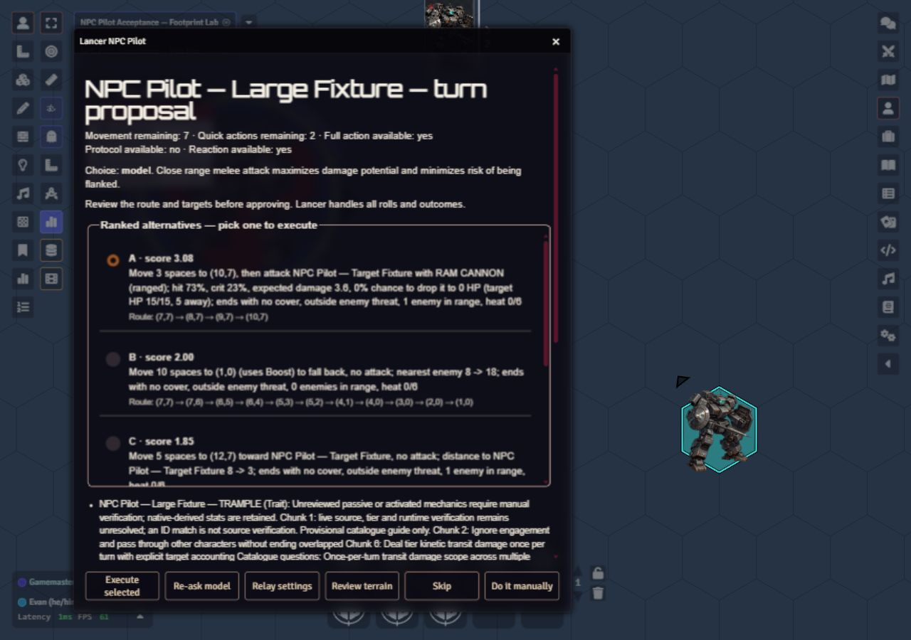

# Lancer NPC Pilot

An AI co-pilot for the GM that plays NPC mechs in a [LANCER](https://massifpress.com/lancer)
game on Foundry VTT. On an NPC's turn, code ranks supported move and attack
options. Choose the opt-in module policy selector without a relay, or use a
language model through Anthropic or Ollama to pick one in character. The GM
approves it, and Foundry and the Lancer system roll the dice.



Historical model-mode review in an isolated scene in the disposable test world, captured November
3, 2026 with development 0.7.0 (d9a1d04 plus this milestone). The seven-space
partial budget was seeded on the fixture; this is a real UI capture, not proof
of naturally retained movement or complete gameplay acceptance.
[Scoped evidence](docs/review-evidence/2026-11-02-execution-acceptance.md).

<!-- doc-media TODO: Capture the 0.8.0 policy review with partial coverage, Re-plan and no-choice controls in an authorized disposable world. Acceptance: inspect real pixels and sanitize token/world details. Blocker: this selector implementation task does not authorize live deployment or world changes. The 0.7.0 image above is historical model-mode evidence. -->

Status: development 0.8.0 source; see the [latest published release](https://github.com/masterevan27/lancer-npc-pilot/releases/latest).
The relay, pure core and GM review module are
implemented; 0.2.0 passed initial local-model and approved Boost checks on a staged
square scene. Full live acceptance is still pending. Execution and automatic turn
prompts default off. The previously staged adapter supports flat equidistant
square grids and all four offset hex layouts, with single-cell Size ½/1 tokens.
Development 0.7.0 adds native Size ½–4 footprints and exact partial-turn budgets;
its independent review and scoped copied-world geometry checks passed. Broader
live acceptance and full special-ability support remain open.
Development 0.4.0 adds excluded-weapon diagnostics and reviewed T1 Ram Cannon
melee/ranged choices. Full NPC special-ability coverage is still being built;
see its [implementation plan](docs/superpowers/plans/2026-11-01-full-npc-coverage.md). See the
[adapter setup and acceptance checklist](docs/foundry-adapter.md) and [design](docs/design.md).

Development 0.6.0 adds source-bound coverage work diagnostics for the installed
roster, including concrete mechanic gates and unresolved source questions.
These guides do not enable special abilities. [Coverage evidence](docs/review-evidence/2026-11-02-coverage-diagnostics.md).

The [roadmap](docs/roadmap.md) records remaining mechanics work and the planned
move toward book-derived class policies, beginning with a T1 base Cataphract.
Development 0.8.0 adds explicit client **Decision mode → Module policy (no relay)**.
The first maintained binding is a T1 base Cataphract. It selects supported ordinary
choices deterministically and reports partial coverage: Trample, Impale and
Point-Defense Shield remain manual. Model mode stays the default. See
[binding and review instructions](docs/foundry-adapter.md#module-policy-mode-development-080)
and [selector evidence and remaining gates](docs/review-evidence/2026-11-03-policy-selector.md).

| Part | Folder | Runs on |
|---|---|---|
| Foundry module | `foundry-module/` | the GM's browser |
| Model relay | `relay/` | the PC that runs the local model (keeps the API key out of the browser) |

Companion projects: [NHP Uplink](https://github.com/masterevan27/foundryvtt-to-sillytavern-nhp-uplink)
(narration) and the [Lancer TTRPG GM Hub](https://github.com/masterevan27/Lancer-TTRPG-GM-Hub).

Install via
Foundry **Setup → Add-on Modules → Install Module → Manifest URL**:

```text
https://github.com/masterevan27/lancer-npc-pilot/releases/latest/download/module.json
```

Use Foundry's **Check Update / Update All** for later published releases. The
relay is installed and updated separately. See [release instructions](docs/VERSIONING.md)
and the [staged setup guide](docs/foundry-adapter.md). Packaging support does not
establish live acceptance; use a disposable world first.

License: GPL-3.0-or-later.
