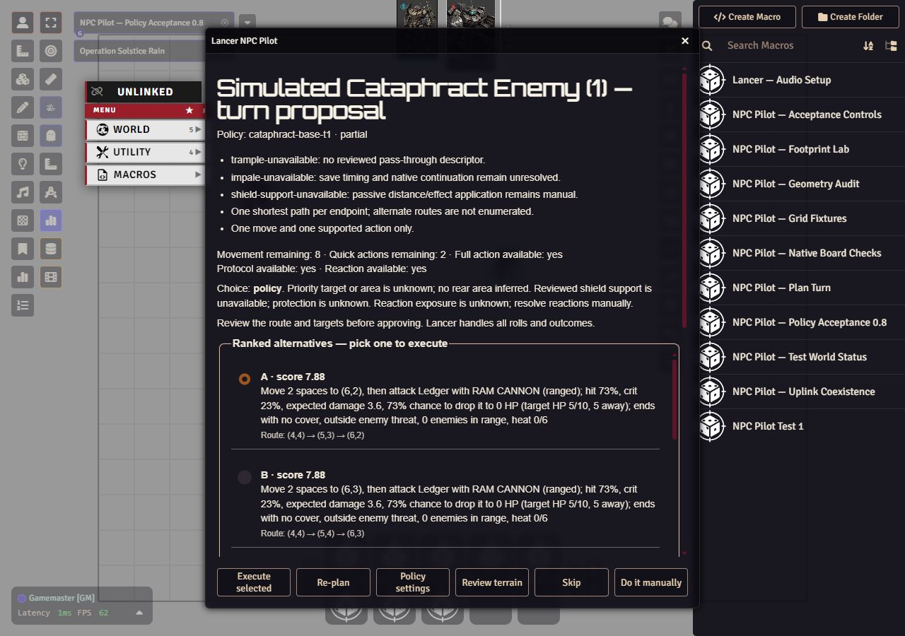
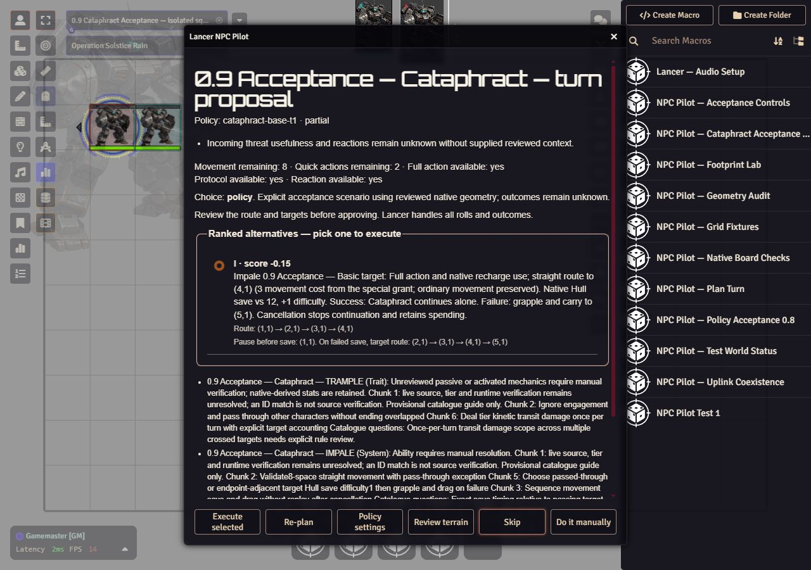

# Lancer NPC Pilot

An AI co-pilot for the GM that plays NPC mechs in a [LANCER](https://massifpress.com/lancer)
game on Foundry VTT. On an NPC's turn, code ranks supported move and attack
options. Choose the opt-in module policy selector without a relay, or use a
language model through Anthropic or Ollama to pick one in character. The GM
approves it, and Foundry and the Lancer system roll the dice.



Real policy-mode review in an isolated disposable-world fixture, captured
November 3, 2026 with development 0.8.0 at `9b0a5df`. The native turn supplies
the displayed budget. Ordinary movement, native Ram Cannon handoff and safety
refusals have scoped live evidence; complete Cataphract mechanics remain open.
[Acceptance evidence and limitations](docs/review-evidence/2026-11-03-policy-acceptance.md).

Status: development 0.10.0 source; see the [latest published release](https://github.com/masterevan27/lancer-npc-pilot/releases/latest).
The relay, pure core and GM review module are
implemented; 0.2.0 passed initial local-model and approved Boost checks on a staged
square scene. Full live acceptance is still pending. Execution and automatic turn
prompts default off. The previously staged adapter supports flat equidistant
square grids and all four offset hex layouts, with single-cell Size ½/1 tokens.
Development 0.7.0 adds native Size ½–4 footprints and exact partial-turn budgets;
its independent review and scoped copied-world geometry checks passed. Broader
live acceptance and full special-ability support remain open.
Development 0.4.0 adds excluded-weapon diagnostics and reviewed T1 Ram Cannon
melee/ranged choices. Full NPC special-ability coverage is still being built;
see its [implementation plan](docs/superpowers/plans/2026-11-01-full-npc-coverage.md). See the
[adapter setup and acceptance checklist](docs/foundry-adapter.md) and [design](docs/design.md).

Development 0.6.0 adds source-bound coverage work diagnostics for the installed
roster, including concrete mechanic gates and unresolved source questions.
These guides do not enable special abilities. [Coverage evidence](docs/review-evidence/2026-11-02-coverage-diagnostics.md).

The [roadmap](docs/roadmap.md) records remaining mechanics work and the planned
move toward book-derived class policies, beginning with a T1 base Cataphract.
Development 0.10.0 adds off-by-default auto mode and NPC banter (source only, live acceptance open; auto-roll is deferred). See the [adapter guide](docs/foundry-adapter/auto-mode-and-banter.md).
Development 0.8.0 adds explicit client **Decision mode → Module policy (no relay)**.
The first maintained binding is a T1 base Cataphract. Development 0.9.0 adds
source-checked Trample routes/damage, native-save Impale continuation, standalone
grapple management and source-specific Shield damage application. Unknown target
passives, prior turn history and stale native cards retain manual paths. This
source has automated/native-source checks; disposable-world acceptance of the
new mechanics remains open. Model mode stays the default. See
[binding and review instructions](docs/foundry-adapter/policy-mode.md)
and [selector evidence and remaining gates](docs/review-evidence/2026-11-03-policy-selector.md).



Real 0.9.0 TEST COPY review captured November 3, 2026 from the dirty development
branch based on `9b0a5df`. Standalone Trample, both Impale save branches, free release, Shield HP/Heat
application and replay refusal, first-turn control, paired movement, and escape
cancellation/completion have scoped native passes. **Step 2 remains blocked** on
Lancer Automations coexistence and broader acceptance. With Automations active,
special/paired movement and Shield application refuse before mutation; resolve
them manually. The current source suite passes 625 tests. The shared module and TEST COPY were restored
to their exact 0.8.0 baseline; the original campaign data hashes were unchanged.
[Native findings and restoration evidence](docs/review-evidence/2026-11-03-cataphract-native-acceptance.md).
The earlier screenshot above records the 0.8.0 ordinary slice.

| Part | Folder | Runs on |
|---|---|---|
| Foundry module | `foundry-module/` | the GM's browser |
| Model relay | `relay/` | the PC that runs the local model (keeps the API key out of the browser) |

Companion projects: [NHP Uplink](https://github.com/masterevan27/foundryvtt-to-sillytavern-nhp-uplink)
(narration) and the [Lancer TTRPG GM Hub](https://github.com/masterevan27/Lancer-TTRPG-GM-Hub).

Install via
Foundry **Setup → Add-on Modules → Install Module → Manifest URL**:

```text
https://github.com/masterevan27/lancer-npc-pilot/releases/latest/download/module.json
```

Use Foundry's **Check Update / Update All** for later published releases. The
relay is installed and updated separately. See [release instructions](docs/VERSIONING.md)
and the [staged setup guide](docs/foundry-adapter.md). Packaging support does not
establish live acceptance; use a disposable world first.

All project documentation is listed in the [documentation index](docs/index.md).

License: GPL-3.0-or-later.
