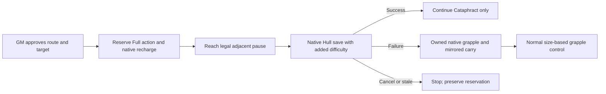

# T1 Cataphract 0.9.0 implementation checks

Scope: uncommitted 0.9.0 source in
`G:/GIT-REPOS/lancer-npc-pilot/.worktrees/tactical-roadmap`, branch
`codex/tactical-roadmap`, based on `9b0a5df`. Root/package/manifest/download
versions agree. No commit, landing, push or release occurred. Separately authorized
temporary runtime staging and TEST COPY mutations are recorded in the
[native findings](2026-11-03-cataphract-native-acceptance.md), including exact
0.8.0 restoration and three unresolved integration gates. Earlier 0.8.0 acceptance
documentation and its real screenshot remain preserved.

This is automated and installed-source evidence, not live special-mechanic
or human tactical-quality acceptance. Generic catalogue dispatch remains
closed; scoped policy source matching grants no other class, tier, template
or optional feature support.

## Source behavior

| Area | Implemented boundary | Manual cases |
|---|---|---|
| Trample | Exact-source T1 passage/engagement exceptions preserve native walls, terrain, full bodies and endpoints; actual contacts delegate fixed 2 kinetic to native damage calculation once per character per turn | Unknown/rejoined/manual movement history, unknown target interactions, reactions |
| Impale | Full/recharge reservation; legal straight route and native Hull +1 difficulty; actual failure creates owned effects and mirrored movement; ordinary movement preserved | Missing native automation, unreviewed target passives/effects, stale/cancelled outcomes, illegal carried geometry |
| Grapple | Independently owned native effects/relations, paired movement, Boost/reaction restrictions, free release, native control/escape checks and mandatory expiry | Multiple grapples, unknown partial-turn action identity, interrupted pending sessions and unsupported changes |
| Shield | Fresh native card, unique source token, complete hostile geometry, explicit GM approval, post-armor native resistance and persistent application claim | Old/stale/reloaded cards, source ambiguity, unsupported defender source |
| Policy | Ordinary/special choices enter selection before pruning; conditional branch identities remain distinct | Useful incoming protection, reactions and displacement objective utility remain unknown without supplied context |

The [source review](2026-11-03-cataphract-source-review.md) attributes the owner's
Impale timing, per-character Trample frequency and standalone ownership rulings.
Native save completion alone authorizes continuation; cancellation retains
spending and cannot become a failed save. UI data never supplies roll receipts.

Opposed checks use ordinary native Hull rolls. Core Book p.13 awards ties to
the actual initiator. Unknown initiation in the pure receipt helper requires
input. Zero HP awaiting native structure resolution does not invent destruction.
Explicit native destruction, zero structure, encounter defeat, deletion and
broken adjacency expire only owned effects. Cleanup waits behind active scene
mechanics and rechecks the current state after waiting.

Shield does not resist Heat as damage. Heat-capacity actors use separate native
damage and Heat steps; heatless conversion remains in one native call so armor
is not applied twice. Native manual half/double and add-Burn choices survive.
Typed resistance, armor, Shredded, Paracausal and overshield remain native.

## Verification

Detailed outputs are ignored files under this checkout's `dist/`. Fixtures
substitute native HUD/roll/document services; installed-source tests execute
selected real Foundry/Lancer code in a VM. Neither establishes actual browser
dialogs, dice, multiplayer synchronization or hooks in a running world.

| Check | Observed result / ignored log |
|---|---|
| Full root suite at standalone-controller checkpoint | 536 passed, one optional roster check skipped; `cataphract-current-full-installed.local.log` |
| Full integrated root suite before final corrections | 601 passed, one optional roster check skipped; `cataphract-integrated-full-installed.local.log` |
| Pre-live root suite with installed Foundry/Lancer/temporary-copy roster checks | 611 passed, zero failed/skipped; original pack hashes unchanged; `cataphract-final-all-native.local.log` |
| Final root suite after live-discovered corrections, all installed checks enabled | **613 passed, zero failed/skipped**; `cataphract-post-live-all-native.local.log` |
| Reviewer module installed-source run | 541 passed, four optional checks skipped; `review-round2-module.local.log` |
| Actual frozen installed three-feature records through production SHA-256 reader | All source tuples verified; shipped Impale correctly uncharged; `cataphract-real-source-conformance.local.log` |
| Installed Shield calculation: armor, resistance, Shredded, Paracausal, Burn/Heat, heatless conversion, multipliers | Two tests with multiple native scenarios passed; `cataphract-shield-native.local.log` |
| Actual movement-hook argument shape | RED then 18 passed; `cataphract-native-hook-shape-{red,green}.local.log` |
| Destruction/structure expiry, waiting/recheck and unresolved zero HP | RED then 32 passed; `cataphract-native-defeat-cleanup-{red,green}.local.log` |
| Printed contested tie rule | RED then 32 passed; `cataphract-contested-tie-{red,green}.local.log` |
| Rejoining preserves claims and invalidates knowledge | RED then 19 passed; `cataphract-rejoin-history-{red,green}.local.log` |
| Local document/import/version check | Nine documents, 101 local targets, 52 runtime modules, 160 relative imports, zero errors; `cataphract-doc-check.local.json` |
| Initial staging ZIP, v0.9.0 | Historical pre-live artifact: 55 entries, 216,916 bytes; `cataphract-zip-check.local.json` |
| Final local review ZIP after native source fixes | 55 entries, 217,202 bytes; runtime bytes match source, manifest JSON matches semantically; `cataphract-post-live-zip-check.local.json` |

The final ignored review ZIP is `dist/lancer-npc-pilot.zip`, SHA-256
`b300c20b9f889ea906db2f77ed3789f56fb89ff3bdc9a9b958337ad7561bc4a0`.
It is not installed or accepted. The initial staged ZIP is preserved as
`dist/lancer-npc-pilot.initial-staged-0.9.0.zip`, SHA-256
`20f8c047e454a9f933d3672a310692511b16aa657cc5f480f90049006e096320`.
The shared runtime is again the original 0.8.0, with exact module/test-world
hash restoration and unchanged campaign data hashes. See the native record and
`cataphract-live-deployment.local.json`. Revalidate actual setup/TEST COPY state
before any future restart. The initial sandbox DNS failure was not an outage.

Runner totals include shared adapter tests imported by fixture helpers; they
are not unique gameplay-scenario totals. Sandbox loopback and PowerShell
AuthorizationManager failures were setup failures. Listed successful root
runs used normal host test permissions. No paid model inference was involved.

Independent execution review used one read-only reviewer for two rounds, model
unrecorded. Round 1 found three P2 issues: late native recharge-settings checks,
noncontacts exhausting the session step limit, and linked-token deletion leaving
owned effects. Round 2 confirmed those corrections and found the movement-hook
argument mismatch and destruction/structure cleanup gap. All received failing
reproductions and corrections. No further critic loop or post-correction
independent acceptance is claimed.

## Continuation and remaining acceptance — blocked

The same worktree continuation passed **625 tests, zero failed/skipped** with
installed sources and roster checks enabled; exit 0, root `node --test`,
`dist/continuation-final-all-native-host.local.log`. Installed sources remain
readonly. Native corrections and exact fixture receipts are in
[native findings](2026-11-03-cataphract-native-acceptance.md#source-continuation-after-restoration).
Scoped new native passes include both Impale save branches, Shield HP/Heat and
duplicate refusal, immediate first-turn control with Ruler Integration 7.3,
paired movement and escape cancellation/completion. No dice were replaced.

Final local ZIP: 55 entries, 218694 bytes, SHA256
`2e183f06cae743d58304e4ab01a1a69e523dd859f36023462ad598e4ffff77f4`;
runtime bytes match current source, manifest matches semantically. This final
ZIP was not installed; native runs used the initial staged continuation ZIP
plus hash-verified source patches. Exact original 0.8.0 module, TEST COPY and
configuration were restored; original campaign hashes matched.

- Automations coexistence remains unsupported. Unawaited engagement updates,
  broad engaged-effect removal and damage bridge changes require an awaited,
  ownership-safe integration seam. Active Automations refuses special/paired
  movement and Shield before mutation. Native movement and Shield refusal were
  observed; the latter preserved HP 15 and Heat 0. A fallback is not coexistence.
- Shield ties, multiple targets, ambiguous sources, stale cards, interrupted
  continuation, deletion cleanup, second-GM/player hooks and large square/hex
  variants still need scoped native acceptance. Unit/conformance coverage is
  separate from these manual gates.
- Human tactical-quality review remains open. The two independent critic rounds
  are exhausted; no new independent acceptance is claimed. Every future native
  staging run must again back up and restore the exact runtime/test world/config.

No pinned OKF bundle exists in this checkout. Scoped local link/source checks
cannot claim pinned-profile compliance or whole-document freshness. The adapter
runbook's existing `stale_after` remains unchanged.
