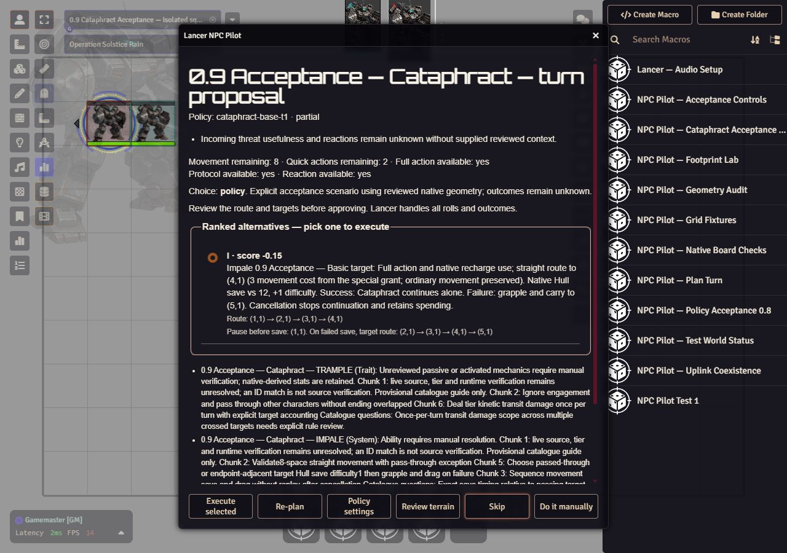
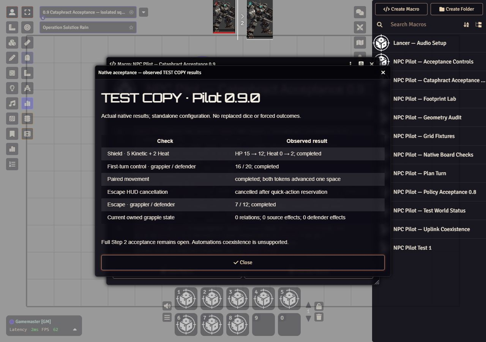

# Cataphract native acceptance — 2026-11-03

Generated: Codex / model unrecorded, 2026-11-03. Branch-only evidence; acceptance remains open.

## Runtime and method

Owner authorized temporary staging, isolated TEST COPY checks and restoration.
Foundry 13.351, Lancer 3.1.3, Pilot 0.9.0; authenticated native Gamemaster.
Only `lancerworldv1-npc-pilot-test` was opened. Fresh copied native actors, scenes
and encounters used normal `activateCombatant` activation; no action-tracker
seeding, roll replacement, forced totals or resource resets.
GM approved the production review, then rolled or cancelled the native Hull HUD.
The test macro recorded actual production execution receipts and forwarded
`damageCalc` calls unchanged through an instance-local observer restored afterward.

Backup and observed macro receipts remain recoverable on the host under
`/home/edekalb/.local/state/npc-cataphract-acceptance-20261103-01a1a2bc`.
Local staging/restore receipts: `dist/cataphract-live-deployment.local.json`.
Initial ZIP SHA256: `20f8c047e454a9f933d3672a310692511b16aa657cc5f480f90049006e096320`.
Subsequent regression-tested runtime source corrections were separately
hash-readback verified: native optional disabled-field readiness and native
effect duration JSON projection, native speaker JSON projection and omitted native
speaker scene compatibility. The initial ZIP does not contain those fixes.

## Observations

1. **Coexistence failure, unresolved:** with Lancer Automations active, the
   repeated transit stopped after `move-1` when automatic Engaged effects changed
   guarded documents. Source and target were both at (200,100); HP stayed 15,
   movement stayed 8; the turn reservation remained. No damage occurred. The
   installed Automations reaction registry maintains engagement on movement.
   This partial movement is not a coexistence pass. Do not broaden the guard to
   accept arbitrary effect changes. Subsequent checks disabled Automations only
   in the backed-up TEST COPY settings.
2. **Standalone readiness defect, fixed:** native NPC feature schemas omit
   `disabled`, while Pilot required strict false. Native source fingerprints
   matched but Trample/Impale/Shield were unavailable. Optional absent/null/false
   now means enabled; true and malformed values still refuse. Regression failed
   before the fix and passed afterward. Broader run: 603 pass, 9 optional skips;
   sandboxed listener/PowerShell failures were setup restrictions, and the same
   unrestricted run had zero failures.
3. **Repeated Trample transit passed standalone:** scene `iPfnjgwes9aF5y7o`,
   combat `VsAN9o0M8xw6rOUk`, source `D0sRT99NE7PWppE3`, target
   `hx4ztFcgzplWWI2K`. Approved route (1,1)-(2,1)-(3,1)-(2,1)-(1,1).
   Completed; one native damageCalc call for 2 Kinetic, HP 15→13, movement 8→4,
   both quick actions retained, protocol spent, one target ledger entry, source
   returned (100,100), target stayed (200,100). Repeated crossing did not repeat
   damage. This does not establish a separate second execution in the same turn.
4. **Native grapple duration defect, fixed:** the first failed save entered the
   grapple branch, created its relation/source effect, then refused before carry.
   Native duration `seconds`, `rounds`, `turns` were undefined, unlike Pilot's
   JSON execution projection. Grapple effect normalization now matches that
   projection. A regression reproduced the exact canonicalData exception, then
   passed; 65 focused executor/grapple tests passed after the correction.
5. **Failed-save carry passed standalone:** scene `u4n2XhH7QobaBZw1`, combat
   `ZgWB152mqKsTdiH6`. Native Hull total −1 versus 12 at difficulty 1.
   Completed owned relation and both native effects, carried target along the
   approved route, source ended (400,100), target (500,100), relation active.
   Full/two quick actions and protocol spent, native recharge consumed; ordinary
   movement stayed 8. HP stayed 15 and no damageCalc call occurred: the carried
   target moved ahead of each source waypoint rather than being crossed.
6. **Free release passed standalone:** native lifecycle UI and its explicit
   confirmation removed the owned relation and both effects. Inspection showed
   no relation, source effects [], target statuses [], and reaction restored.
7. **Native save cancellation passed standalone:** scene `Lek4095vf2PJe2Yt`,
   combat `j6snYljdjJFAhbEW`. Cancelled actual Hull HUD before rolling. Receipt
   cancelled at save; Full/two quick actions and recharge remained spent,
   ordinary movement 8, unchanged positions/HP, no effects/relation/damage calls.
8. **Additional natural failed save:** scene `NHjNwIlrlo1BTO2D`, combat
   `fKdfmBePh21HViQt`, Hull total 2 against 12 at difficulty 1; failed carry
   completed again, no forced outcomes.
9. **Native control-start failure, unresolved:** scene `7sc97Q7qBX2nnalx`, combat
   `NV3LerUSlvzYLVoJ`. A further natural save total −1 failed and carry completed.
   Native defender activation was followed by a control-contest request, which
   refused with "A same-size contest requires the observed start-of-turn window."
   The controller captures before native async turn refresh and clears the window
   on every chat message, including native turn banners. No control rolls/spending
   occurred. This is a failed gate, not a supported live contest.
10. **Native escape loss:** in that same fixture, defender approved one quick
    action and both actual Hull HUDs. Native chat showed grappler 20 (d20=19),
    defender 8 (d20=7). The relation and effects correctly remained. This does not
    establish the winning or cancellation branch; raw operation/budget evidence
    remains in the preserved tested world.
11. **Shield failures, not an application pass:** native manual DamageRollFlow
    produced GM-configured 5 Kinetic + 2 Heat cards through its real HUD and Roll.
    This was an explicit manual damage test input, not a fabricated attack result.
    First Apply exposed `speaker.alias=undefined`; normalized native-card JSON
    fixed the reproduced exception. Lancer 3.1.3's native card helper omits
    `speaker.scene`, including token-backed speakers. A further RED/GREEN fix
    permits null scene only with the exact token/actor in the captured board;
    nonmatching explicit scenes and missing token identities still refuse.
    Final fresh token-backed card `NyjU3nQu1HmxfUQd`, scene `aRs7omeMkBCoWGX5`,
    source token `xs3twHT6eWrRyLyt`, target `5OVuHwcrwpwum6qo`, reached source
    review and refused "Invalid plain native actor source." HP stayed 15 and
    Heat 0. At this point, native actor inert-data incompatibility was undiagnosed:
    a simple enumerable-node probe found no nonfinite numbers/nonplain objects,
    but did not inspect descriptors, symbols, array prototypes or sparse arrays.
    Do not claim Shield resistance, Heat preservation or duplicate-Apply behavior
    passed in the browser.

Captured from hidden in-app browser, 2026-11-03, development 0.9.0 dirty branch
based on `9b0a5df`; actual TEST COPY fixture, not a mockup. This records review
disclosure only. Historical catalogue warnings visible below the scoped review
remain conservative and do not establish feature acceptance.

## Restoration and final source checks

`py -3.11 dist/cataphract-live-host.local.py restore` completed with exit 0:
`moduleRestored=true`, `testWorldRestored=true`, `originalCampaignUnchanged=true`,
`version=0.8.0`. Checks compared all original module/test-world files and original
campaign data against the pre-stage SHA256 baselines; startup config was restored
from the same archive. Tested module/world directories were retained beside the
backup for recoverable receipts. Server restarted to authentication/setup, with
no campaign launch. Browser viewport was reset; no credentials were changed.

Final source suite, root `node --test` with `PILOT_FOUNDRY_CODE`,
`PILOT_LANCER_SYSTEM`, `PILOT_NPC_PACK`: **613 passed, zero failed/skipped**,
exit 0; `dist/cataphract-post-live-all-native.local.log`. Roster code opens only
a disposable copy and verifies original pack hashes unchanged. These are source
tests, not completion of the failed native gates.

Local build `./tools/build-release.ps1 -Tag v0.9.0`, exit 0: 55 entries, 217,202
bytes, SHA256 `b300c20b9f889ea906db2f77ed3789f56fb89ff3bdc9a9b958337ad7561bc4a0`.
Runtime bytes match source and manifest JSON matches semantically; packaging
normalizes manifest formatting. This local ZIP is not deployed or accepted.

## Pending gates at the previous restoration

Step 2 is blocked on the three reproduced native integration failures: Shield
actor-source acceptance, same-size control start timing, and Automations movement
effects. The two independent critic rounds were already consumed; no third
builder/critic loop or independent acceptance is claimed. Successful native save
was not observed in the bounded fresh attempts. Shield ties/Heat/application,
grapple winning escape/cancellation/paired movement, deletion cleanup, native
replay/stale-state and multiplayer checks remain open. No full Step 2, tactical
quality or release acceptance is claimed. Next exact action: diagnose the raw
actor source's first failing inertData node using descriptors and array shape,
then handle native turn-start completion and Automations coexistence explicitly.

## Source continuation after restoration

November 3, 2026 (checks completed November 4 UTC), same dirty
`codex/tactical-roadmap` worktree at `9b0a5df`, development 0.9.0.
This continuation supersedes the earlier pending Shield/control/save/paired/
escape observations only for the exact cases below. Full Step 2 remains blocked.

Actual native-state/receipt panel captured November 3, 2026 (November 4 UTC),
dirty branch based on `9b0a5df`, Pilot 0.9.0, Foundry 13.351, Lancer 3.1.3.
The TEST COPY macro displays actual native receipts and document readbacks;
it is not a mockup or an independent acceptance review. The panel includes the
remaining Automations caveat. Browser testing stayed hidden.

### Diagnoses and bounded source corrections

- Foundry `DocumentStatsField._shimData` adds a non-enumerable
  `flags.exportSource` accessor during `Actor.toObject`. Shield now serializes
  this trusted native source at the JSON boundary before strict source review,
  preserving item version metadata. Strict direct accessor rejection is unchanged.
  Installed-source regression calls the actual shim; its getter is never read.
- Lancer 3.1.3 starts action/reaction refreshes without awaiting them. Control
  observes only exact one-time active/previous tracker and reaction transitions
  against the full board. First native control still failed until a read-only
  trace identified Lancer Ruler Integration 7.3's deferred current-combatant
  `turn-status` flag and associated metadata write. The integration now accepts
  exactly the captured statuses once for that combatant/version; different
  flags/statuses, drift-and-restore, movement, rolls and action flows refuse.
  No global guard field was excluded and no third-party code was changed.
- A contest retaining the existing controller can produce a native no-op update
  receipt `[]`. Exact already-matching owned effect state now completes without
  issuing that redundant write. Other writes retain receipt validation.
- Native `TokenDocument.move` can resolve before animated coordinates commit.
  Standalone paired movement now awaits `movementAnimationPromise` before its
  strict position check, matching the Cataphract executor's existing boundary.
- Automations 4.5.5.2 engagement activation does not await engagement completion;
  removal matches any engaged effect, including Pilot-owned grapples. Its damage
  bridge also caused board drift after HP application and before Heat in the
  initial active-module Shield attempt (HP 15→12, Heat remained 0). Full coexistence
  is unsupported. Special/paired movement now refuses before reservation/costs;
  Shield refuses before claims/damage. Other module effects remain guarded.

### Actual native observations

No roll values or outcomes were forced. Native HUDs and explicit GM review were
used; fresh copied fixture actors were prepared without resetting used resources
or rewriting outcomes. Raw receipts are retained in
`dist/continuation-native-ui.local.json` and the backed-up tested world.

| Case | Actual result and recoverable identity |
|---|---|
| Standalone Shield | Scene `JVoFigQnDSTVter6`, native card `gp19RsrOAddc13Sr`: approved 5 Kinetic + 2 Heat, HP 15→12, Heat 0→2, operation completed. Second Apply refused the already-claimed target; no extra loss. |
| Successful Impale save | Scene `p5U3YdieDNckq0p2`: native save 18 vs 12 with +1 difficulty succeeded. Source reached (400,100); target stayed (200,100); no grapple/effects. Actual transit dealt 2 Kinetic once. Full/recharge spent, movement 8 preserved. |
| Failed save and first-turn control | Scene `t7iQUURLUQuPKUSW`, combat `lXpbMj0GHPDP9esk`, source `mbphbBphZFXmiCdu`, defender `B1A13l4PHg7YfXs3`: save 6 vs 12 with +1 difficulty failed; carry reached (400,100)/(500,100). First defender activation with ruler 7.3 active allowed native Hull 16/20; defender became controller, both owned effects updated, no quick action spent. |
| Paired movement | Same fixture: approved route 5,1→6,1 completed both native moves and end-carry. Defender/source reached (600,100)/(500,100), defender movement 8→7, quick actions preserved, relation active. |
| Escape cancellation | Same turn: approved quick-action reservation, then cancelled actual first Hull HUD. Receipt cancelled at source-check; one quick remained, positions/HP/owned grapple state retained. |
| Winning escape | Normal next-round activation, no resource reset: actual Hull 7/12. Both checks completed, both owned effects removed and relation cleared. |
| Automations movement fallback | Scene `h1regtfeTRCcogcg`: approved special movement refused before costs/movement, full/quick/move 8 and HP 15 retained, no ledger/relation. |
| Automations Shield fallback | Fresh scene `nz9PLJ9xGAdjsjUv`, card `kAhHamdGOqTKK9iW`: native Apply reported manual Shield resolution/No damage was applied. HP stayed 15, Heat 0, no application claim/operation, no grapple/effects. This is a refusal pass, not coexistence support. |

Earlier failed control/no-op/paired attempts remain in raw receipts; they are
not counted as passes. The exact deferred ruler write was captured in
`dist/continuation-native-control-trace-immediate.local.json`; related traces
and readonly installed sources are under ignored `dist/native-continuation`.

### Verification and restoration

Root `node --test` with installed Foundry/Lancer and roster variables, normal
Windows host permissions: **625 passed, zero failed/skipped**, exit 0;
`dist/continuation-final-all-native-host.local.log`. Focused RED/GREEN evidence
covers Shield, turn refreshes, Automations, native no-op writes, animation and
the exact ruler transition (`continuation-*-{red,green}.local.log`). Runner totals
include imported adapter tests, not unique gameplay scenarios. Initial listener/
PowerShell/roster-path/archive-discovery failures were setup failures; archived
source was retained under `dist/node_modules/retained-evidence`, with all 74
previous manifest hashes matching. No paid model inference occurred.

Initial continuation ZIP: 55 entries, 218132 bytes, SHA256
`1050c9c0965bd63035effc4cec0a586f0bab2652ea6a32bcc0056db6bf6f5ed9`.
It was staged only for TEST COPY, then corrected source files were patched with
hash readback. Initial ZIP/manifest remain in
`dist/staged-continuation-20261103`. Final local rebuild
`./tools/build-release.ps1 -Tag v0.9.0`, exit 0: 55 entries, 218694 bytes, SHA256
`2e183f06cae743d58304e4ab01a1a69e523dd859f36023462ad598e4ffff77f4`.
All runtime bytes match current source; manifest matches semantically. The final
ZIP itself was not installed, published or accepted.

Fresh remote backup namespace:
`/home/edekalb/.local/state/npc-cataphract-native-20261103-01a1a3e4`.
Recovery command `py -3.11 dist/continuation-live-host.local.py restore`, exit 0,
returned `moduleRestored:true`, `testWorldRestored:true`,
`originalCampaignUnchanged:true`, `version:0.8.0`. Exact module/test-world/config
baseline hashes and original campaign data hashes matched. The tested runtime
and world are retained separately in that namespace. Receipt:
`dist/continuation-live-deployment.local.json`. Original startup configuration
was restored; credentials were unchanged. Temporary browser viewport was reset.

Next exact action: review the blocked coexistence seam before authorizing any
new staging. Remaining native gates include Shield ties/multiple targets/source
ambiguity/stale cards, stale continuation, deletion cleanup, multiplayer/second
GM and large square/hex variants. Human tactical review remains separate. The
two independent critic rounds are exhausted; no new independent acceptance,
complete Step 2, landing, commit or release is claimed.
