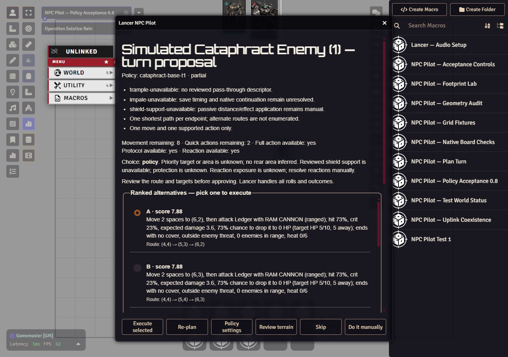

# Disposable-world policy acceptance

Agent: Codex / unrecorded. These are scoped agent observations, not GM
acceptance of tactical quality or complete Cataphract support.

## Environment and authority

Tested local revision `9b0a5df785cff11c009dae71e583f88a30e7bf16`, development
0.8.0, with Foundry 13.351 and Lancer 3.1.3 in
`LancerWorld — NPC Pilot TEST COPY` on November 3, 2026. The owner explicitly
approved stopping the shared Foundry container, backing up the installed
module and copied world, updating the shared module, and reopening only TEST
COPY. This approval followed an automatic review refusal of the initial
shared-server update. The owner completed administrator sign-in and launched
the copied world. The original campaign was not opened or edited.

The stopped-world backup is retained on the server at
`/home/edekalb/.local/state/npc-policy-acceptance-20261103-01a1a27b/before.tgz`.
All 34 staged runtime/manifest/style files passed SHA-256 readback against the
tested checkout. An initial overly broad staging filter also copied 44 test
files; these task-added files were moved into the backup's `staging-extras/`
directory after verifying they did not pre-exist. No existing file was removed.
The runtime remains at the approved 0.8.0; no release or push was performed.

A separate square scene, two cloned native actors and a new encounter isolated
the tests from existing copied-world actors and encounters. The Cataphract
clone was native T1 with exactly one class and its four base features. The GM
bound it through the maintained API. Terrain was a deliberately empty, reviewed
test scene. Native Lancer activation supplied the eight-space movement and two
quick-action budget; those resources were not seeded by the harness. Uplink
was inactive. No paid or local-model inference was used.

## Observed checks

| Check | Result and boundary |
|---|---|
| Disconnected policy review | Passed. The real Plan Turn macro opened `cataphract-base-t1 · partial`, eight ordinary alternatives and conservative special-mechanic warnings. A browser probe prohibited relay transport and secret reads: both counters remained zero through planning, configuration and approved handoff. The local relay port had no listening process at the inspected preflight. |
| Execution disabled | Passed. The review showed its disabled explanation and omitted Execute; Skip remained the default. The footer controls were visible at 1280×900. |
| Re-plan and policy settings | Passed. Re-plan reproduced the same initial options. Policy settings opened mode/binding guidance without a relay or secret prompt. |
| Skip and manual cancellation | Passed. Both exited review with NPC position, HP and native budget unchanged and no execution reservation. |
| Changed board | Passed. Moving the cloned target after review caused approval to refuse with `The board or turn changed. Re-plan before approving.` No execution mutation followed. |
| Changed binding | Passed. Changing the clone's binding after review refused old approval. A new review was unconfigured, with no Execute and an available manual path. The reviewed binding was then restored. |
| Changed rule source | Passed. Editing only the clone's Ram Cannon effect after review refused old approval. Re-planning reported its unavailable reviewed source and removed attack choices while retaining ordinary movement. The original effect was restored before native handoff. |
| Approved move plus Ram Cannon | Passed to native handoff. Round 1 option A moved from square cell (4,4) to (6,2), then opened the native ranged Ram Cannon HUD with Range 5 and Ledger targeted. The GM selected Cancel in that HUD. No attack or damage roll occurred; HP remained 15/5. Movement changed 8→6; the native tracker retained one quick action. |
| Replay after native cancellation | Passed. The persistent execution reservation remained. A second Plan Turn refused with `This NPC turn was already handed to execution. Continue manually.` No reservation was cleared for retry. |
| Approved movement only | Passed. On native round 2 activation, explicitly selected F moved (6,2)→(9,4), spent three movement (8→5), retained both quick actions and the full action, and left HP 15/5. No attack HUD followed. |
| Actual player client | Passed with owner-assisted evidence. The signed-in role-2 player ran the read-only diagnostic and supplied its screenshot: version 0.8.0, `isGM: false`, `apiPresent: false`, and planning/binding functions undefined. The owner also reported that Alt+P did nothing. Automated player initialization tests pass independently. This checks the real player entry point, not hostile-client security or every multi-GM case. |

The probes were test instrumentation, not product changes. The initial settings
probe failed to forward Foundry's optional document argument, causing three
test-created duplicate execution-setting records and false readback. After
diagnosing the dropped argument, the probe forwarded all arguments, removed
only those three task-created records and verified the native setting update.
The successful executable-review tests above followed that correction. A
separate harness edit initially failed compilation because two concatenated
blocks declared the same constants; block scoping corrected it before execution.
Neither issue is recorded as a product failure.

## Policy UI capture

Captured November 3, 2026 from the hidden browser at 1280×900, using the exact
0.8.0 runtime above and the isolated square fixture. Pixels were inspected
before saving. This is the real pre-approval UI, not a mockup or evidence of
special-mechanic execution. The native attack HUD was captured separately in
ignored local evidence.

## Cleanup and recoverable evidence

The fixture scene, encounter and both cloned actors were removed. Execution and
turn prompts were verified false; model mode, the original viewed scene and
paused state were restored. All existing actors matched the pre-fixture SHA-256
baseline. All six original scene documents matched their hashes. All three
original encounters matched their baseline documents after excluding only
`_stats` update metadata. Native chat messages from fixture activations remain
as test history; no whole-world byte-identity claim is made.

Temporary probes were restored to their original browser functions and the
stale test client was closed. The owner supplied the player diagnostic screenshot;
its private copy is retained in ignored evidence. The temporary player macro
and fixture backup flag were removed. The GM-only acceptance macro now reads
the retained cleanup receipt without changing the world; final readback confirms
the player diagnostic is absent and both execution settings remain off. The
remote backup remains available.
Ignored `dist/policy-live-deployment.local.json`,
`policy-live-handoff-status.local.txt`, `policy-live-movement-status.local.txt`,
`policy-live-cleanup.local.txt`, `policy-live-final-receipt.local.txt`,
`policy-live-player-boundary.local.png` and
`policy-live-native-hud.local.jpg` in the
retained tactical-roadmap checkout hold scoped deployment, native-state and
image evidence. No credentials or provider keys were included.

## Source checks and remaining scope

| Command | Observed result |
|---|---|
| `node --test foundry-module/test/policy-controller.test.mjs foundry-module/test/policy-context.test.mjs foundry-module/test/policy-review-regressions.test.mjs foundry-module/test/controller.test.mjs foundry-module/test/executor.test.mjs foundry-module/test/ui.test.mjs` | 64 passed, zero failed/skipped; exit 0. `dist/policy-live-source-checks.local.log`. |
| `node --test` | 369 passed, zero failed, seven optional installed-dependency checks skipped; exit 0. `dist/policy-live-full.local.log`. This run does not replace the earlier 376-pass installed-source receipt. |

The source suite needed the normal execution environment for loopback HTTP and
PowerShell packaging. Restricted SSH DNS and Python CA/proxy access initially
failed in the sandbox; approved execution resolved those setup restrictions.
Stale browser handles were recovered without discarding world state.

This pass covers the current ordinary T1 policy slice on a square fixture.
Trample, Impale save timing/native continuation, Point-Defense Shield behavior,
other tiers/options/templates/classes, actual policy attack outcomes, broader
interruptions, cross-GM concurrency and active Uplink coexistence remain outside
this acceptance scope. No pinned OKF bundle/checker exists; unrelated adoption
was not attempted. GM review of tactical quality remains a human gate.
